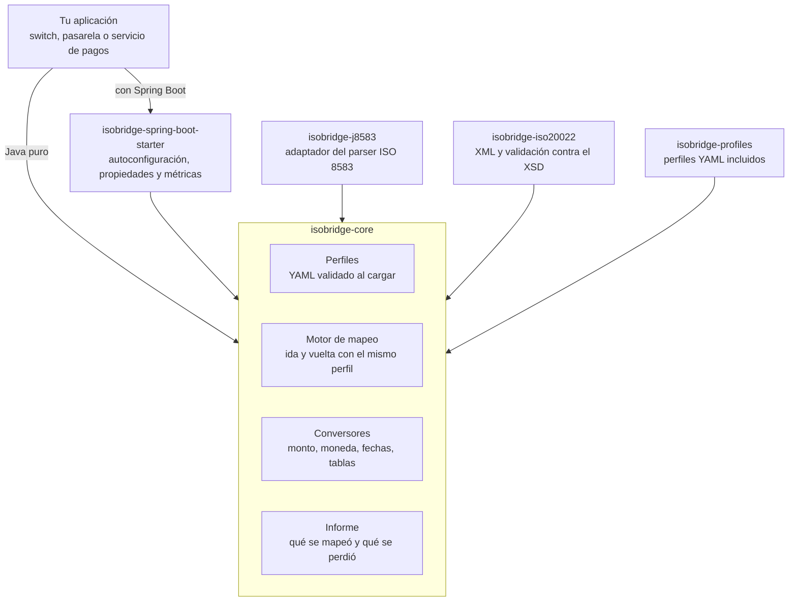

# Arquitectura

El núcleo no depende de Spring ni de un parser concreto. Contiene toda la lógica y solo depende del lector de YAML. Los demás módulos lo rodean: adaptadores para cada estándar, los perfiles incluidos y el starter, que es una capa fina de configuración.



Cada flecha apunta al módulo del que se depende.

## Módulos

| Módulo | Responsabilidad | Depende de |
| --- | --- | --- |
| `isobridge-core` | Modelo de perfil, motor de mapeo, conversores, informe e interfaces de mensaje | SnakeYAML |
| `isobridge-iso20022` | Leer y escribir el XML por rutas, en el orden del XSD, y validarlo | `core` |
| `isobridge-j8583` | Envolver un mensaje de j8583 en la interfaz `Iso8583Message` | `core`, j8583 |
| `isobridge-profiles` | Perfiles YAML incluidos, con sus pruebas de ida y vuelta | `core` |
| `isobridge-spring-boot-starter` | Autoconfiguración, propiedades, métricas e indicador de salud | Todos los anteriores, Spring Boot |
| `isobridge-samples` | Aplicación de ejemplo con un endpoint REST; no se publica | El starter |

## Reglas de dependencia

- `core` no importa Spring, j8583 ni ninguna librería de ISO 20022.
- Los estándares entran por dos interfaces del núcleo: `Iso8583Message` para un lado y `XmlDocumentAccess` para el otro. `XmlDocumentAccessFactory` crea el documento de cada conversión sin que el núcleo conozca el XML.
- El starter no contiene lógica de conversión; todo lo que hace se puede hacer con el constructor de Java puro.
- Ningún módulo depende de `isobridge-samples`.

`XmlDocumentAccess` es la interfaz con la que el motor lee y escribe valores en un documento XML por ruta, sin conocer la implementación. `isobridge-iso20022` la implementa sobre DOM. `XmlDocumentAccessFactory` recibe el tipo de mensaje y la raíz del perfil y devuelve un documento vacío; el `Builder` de `IsoBridge` la exige, de modo que el núcleo no depende de `isobridge-iso20022`.

## Flujo de conversión

Cada conversión entrega el mensaje y su informe. Sentido de ida, de ISO 8583 a ISO 20022:


- Cada etapa anota su resultado en el informe, que acompaña al mensaje en la salida.
- El perfil se lee y se valida una sola vez, al construir el puente. Una conversión solo recorre estructuras ya preparadas.
- Dos puntos pueden detener el flujo con una excepción: un campo obligatorio ausente al leer y un XML que no cumple su XSD al validar. Todo lo demás termina en un resultado con su informe.
- La vuelta recorre las mismas etapas al revés: lee el XML por sus rutas, aplica la operación inversa de cada conversor y escribe los campos ISO 8583.

## Orden de los elementos XML

Los XSD de ISO 20022 exigen que los elementos aparezcan en un orden fijo. El perfil declara los mapeos en cualquier orden, así que quien escribe el XML debe ordenarlos. `isobridge-iso20022` incluye los esquemas que necesita, extrae de cada uno el orden y el tipo de sus elementos (`SchemaModel`, una sola vez por recurso de classpath) y los aplica al escribir (`DomXmlDocumentAccess`). La alternativa de escribir sobre las clases de Prowide quedó descartada: añadía una dependencia grande y el orden seguía siendo responsabilidad nuestra.

Los esquemas se guardan sin modificar en `isobridge-iso20022/src/main/resources/iso20022/`:

| Fichero | Mensaje | Origen | SHA-256 |
| --- | --- | --- | --- |
| `pacs.008.001.08.xsd` | `FIToFICstmrCdtTrf` | <https://www.iso20022.org/sites/default/files/documents/messages/pacs/schemas/pacs.008.001.08.xsd> | `cf048155f70cacd03f1f1dfadf66cba8752be93c249c267351782fd6adb023f7` |
| `pacs.002.001.12.xsd` | `FIToFIPmtStsRpt` | <https://www.iso20022.org/sites/default/files/documents/messages/pacs/schemas/pacs.002.001.12.xsd> | `c6ec04854583d87506ca9baa02c27a50001c3518ad46ca6892da1d515e074a0a` |

Ambos se descargaron el 13 de noviembre de 2026 y son autocontenidos: no importan ni incluyen otros esquemas. Del XSD solo se leen la estructura de elementos y sus tipos; las restricciones, los atributos y los tipos simples se usarán para validar en la fase 2.

## Estructura del repositorio

```text
isobridge/
├── isobridge-core/                 Motor, perfiles, conversores e informe
├── isobridge-iso20022/             Lectura y escritura del XML, validación XSD
├── isobridge-j8583/                Adaptador para mensajes de j8583
├── isobridge-profiles/             Perfiles YAML incluidos y sus pruebas
├── isobridge-spring-boot-starter/  Autoconfiguración, propiedades, métricas
├── isobridge-samples/              Aplicación de ejemplo con un endpoint REST
├── docs/                           Esta documentación
├── AGENTS.md                       Instrucciones para agentes de IA
├── pom.xml
└── README.md
```

Paquetes dentro de `isobridge-core`, bajo `io.github.suricatoaviones.isobridge`:

| Paquete | Contenido |
| --- | --- |
| (raíz) | `IsoBridge`, `ConversionResult`, excepciones públicas |
| `profile` | `Profile`, `FieldMapping`, `MessageSpec`, `Direction`, carga y validación del YAML |
| `convert` | `FieldConverter`, registro de conversores y los conversores incluidos |
| `report` | `ConversionReport`, `ReportEntry`, `Status`, enmascarado |
| `message` | `Iso8583Message`, `XmlDocumentAccess`, `XmlDocumentAccessFactory` |
| `internal` | Motor de mapeo; no es API pública |
