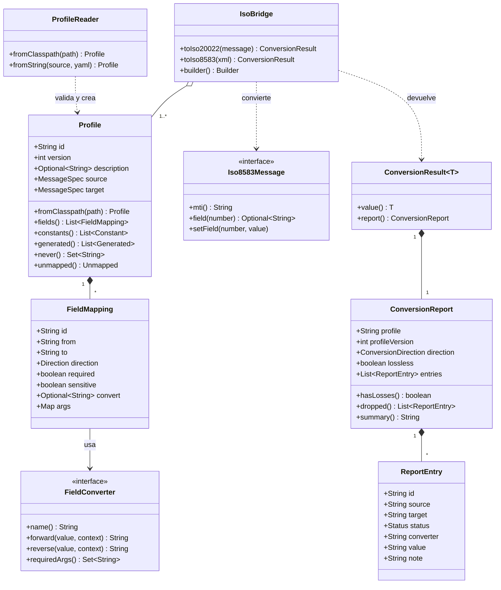

# Modelo de clases

`IsoBridge` es la única entrada; todo resultado trae su informe.



Rombo relleno: composición. Rombo vacío: agregación. Línea punteada: dependencia.

`IsoBridge` agrupa uno o más perfiles y expone las dos conversiones. Cada perfil se compone de mapeos de campo, y cada mapeo usa un conversor. Toda conversión devuelve un `ConversionResult`, que lleva el mensaje y su informe.

## Naturaleza de cada tipo

| Tipo | Naturaleza | Nota |
| --- | --- | --- |
| `IsoBridge` | Clase final inmutable | Se construye con un `Builder`; segura entre hilos |
| `Profile` (con `Constant`, `Generated` y `Unmapped` anidados), `FieldMapping`, `MessageSpec` | `record` | Se crean al leer el YAML, ya validados; inmutables y con igualdad por valor |
| `ProfileReader` | Clase final inmutable | Lee y valida el YAML; recibe el `ConverterRegistry` con el que comprueba los nombres de conversor |
| `FieldReference` | Interfaz sellada (`Mti`, `DataElement`) | Referencia a un campo ISO 8583: `mti`, `de4`, `de3[0:2]` o `de48.01` |
| `ElementPath` | `record` | Ruta relativa a un elemento o atributo del XML ISO 20022 |
| `ProfileException` | Excepción final | Lleva todos los errores de la carga, cada uno con su línea y su motivo |
| `FieldConverter` | Interfaz | Punto de extensión; los incluidos se registran por nombre |
| `ConversionContext` | Interfaz | La implementa el motor: reloj, otros campos del mensaje y `args` |
| `ConverterRegistry` | Clase final inmutable | Conversores indexados por nombre; `withBuiltIns()` trae los incluidos |
| `Iso8583Message` | Interfaz | La implementa un adaptador por cada parser |
| `MapIso8583Message` | Clase mutable de pruebas | Implementación en memoria de `Iso8583Message`; vive en `src/test` |
| `XmlDocumentAccess` | Interfaz | Lee y escribe valores del XML por ruta; la implementa `isobridge-iso20022` |
| `ConversionResult`, `ConversionReport`, `ReportEntry` | `record` | `ConversionResult<T>` es genérico: lleva un XML (`String`) o un `Iso8583Message` |
| `Masking` | Clase final con métodos estáticos | Enmascara el PAN y los campos sensibles antes de guardarlos en el informe |

## Enumeraciones

```java
public enum Direction { BOTH, FORWARD, REVERSE }

public enum Status { MAPPED, DEFAULTED, GENERATED, INFERRED, SUPPLEMENTARY, DROPPED, EXCLUDED }

public enum ConversionDirection { ISO8583_TO_ISO20022, ISO20022_TO_ISO8583 }
```

## Firmas principales

```java
public final class IsoBridge {
    public static Builder builder();
    public ConversionResult<String> toIso20022(Iso8583Message message);
    public ConversionResult<Iso8583Message> toIso8583(String xml);

    public static final class Builder {
        public Builder profile(Profile profile);
        public Builder converter(FieldConverter converter);
        public Builder clock(Clock clock);
        public Builder idGenerator(Supplier<String> idGenerator);
        public Builder strict(boolean strict);
        public Builder validateXsd(boolean validate);
        public IsoBridge build();
    }
}

public interface FieldConverter {
    String name();
    String forward(String value, ConversionContext context);
    String reverse(String value, ConversionContext context);
    default Set<String> requiredArgs() { return Set.of(); }

    static FieldConverter of(String name, UnaryOperator<String> forward, UnaryOperator<String> reverse);
}

public interface ConversionContext {
    Clock clock();
    Optional<String> field(String reference);
    Optional<Object> argument(String name);
}

public final class ConverterRegistry {
    public static ConverterRegistry empty();
    public static ConverterRegistry withBuiltIns();
    public ConverterRegistry register(FieldConverter converter);
    public Optional<FieldConverter> byName(String name);
}

public final class ProfileReader {
    public ProfileReader(ConverterRegistry registry);
    public Profile fromClasspath(String path);
    public Profile fromString(String source, String yaml);
}

public final class ProfileException extends IsoBridgeException {
    public List<Error> errors();
    public record Error(int line, String reason) {}
}

public sealed interface FieldReference permits FieldReference.Mti, FieldReference.DataElement {
    String text();
    static FieldReference parse(String text);

    record Mti() implements FieldReference {}
    record DataElement(int number, Optional<Slice> slice, Optional<String> subfield)
        implements FieldReference {}
    record Slice(int start, int endExclusive) {}
}

public record ElementPath(List<String> elements, Optional<String> attribute) {
    public static ElementPath parse(String text);
    public boolean isAttribute();
}

public record ConversionReport(
    String profile,
    int profileVersion,
    ConversionDirection direction,
    boolean lossless,
    List<ReportEntry> entries) {

    public static ConversionReport of(
        String profile, int profileVersion, ConversionDirection direction, List<ReportEntry> entries);
    public boolean hasLosses();
    public List<ReportEntry> dropped();
    public String summary();
}

public record ReportEntry(
    String id,
    String source,
    String target,
    Status status,
    String converter,
    String value,
    String note) {

    public static ReportEntry of(FieldMapping field, Status status, String value, String note);
    public static ReportEntry of(FieldMapping field, Status status, String note);
}

public final class Masking {
    public static String mask(FieldMapping field, String value);
    public static String maskCardNumber(String value);
}

public interface Iso8583Message {
    String mti();
    Optional<String> field(int number);
    void setField(int number, String value);
    Set<Integer> presentFields();
}

public interface XmlDocumentAccess {
    Optional<String> read(String path);
    void write(String path, String value);
    String toXml();
}

public record Profile(
    String id,
    int version,
    Optional<String> description,
    MessageSpec source,
    MessageSpec target,
    List<FieldMapping> fields,
    List<Constant> constants,
    List<Generated> generated,
    Set<String> never,
    Unmapped unmapped) {

    public record Constant(String to, String value) {}
    public record Generated(String to, String with) {}
    public enum Unmapped { REPORT, FAIL, SUPPLEMENTARY }

    public static Profile fromClasspath(String path);
}

public record FieldMapping(
    String id,
    String from,
    String to,
    Direction direction,
    boolean required,
    boolean sensitive,
    Optional<String> convert,
    Map<String, Object> args) {}

public record MessageSpec(
    String standard,
    Optional<String> mti,
    Optional<String> message,
    Optional<String> root) {

    public static MessageSpec iso8583(String mti);
    public static MessageSpec iso20022(String message, String root);
}
```

## Módulo `isobridge-iso20022`

```java
public final class DomXmlDocumentAccess implements XmlDocumentAccess {
    public static DomXmlDocumentAccess create(String schemaResource, String rootPath);
    public static DomXmlDocumentAccess parse(String xml);
    public static DomXmlDocumentAccess parse(String xml, String rootPath);
    public Optional<String> read(String path);
    public void write(String path, String value);
    public String toXml();
}
```

`create` empieza un documento vacío para el XSD y el `target.root` del perfil, por ejemplo `/Document/FIToFICstmrCdtTrf`, y deja las rutas apuntando al último elemento. `parse(xml)` envuelve un XML existente y deja las rutas apuntando al elemento raíz del documento; `parse(xml, rootPath)` las apunta al mismo `target.root` del perfil. `write` crea los elementos que falten y los inserta en el orden que declara el XSD, y reutiliza el primero que ya exista con ese nombre: las rutas no distinguen repeticiones, porque un 0200 mapea una sola transacción.

`ConversionContext` da al conversor acceso de solo lectura a los demás campos del mensaje, a los argumentos declarados en el perfil (`args`) y al reloj. Lo necesita, por ejemplo, el conversor de monto para conocer la moneda.

`presentFields()` permite al motor saber qué campos venían en el mensaje y no fueron mapeados, para reportarlos como `DROPPED`.
