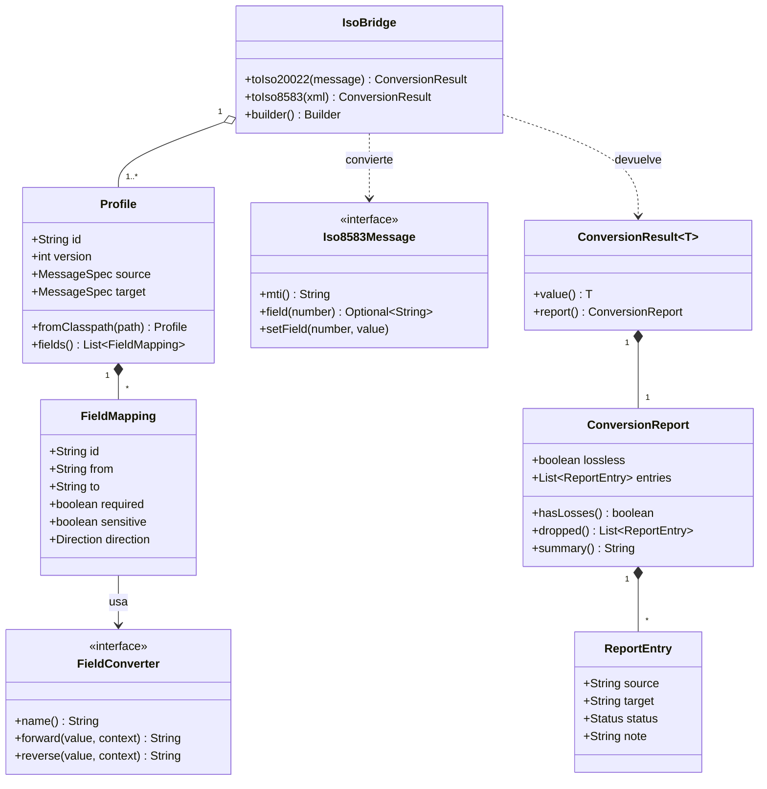

# Modelo de clases

`IsoBridge` es la única entrada; todo resultado trae su informe.



Rombo relleno: composición. Rombo vacío: agregación. Línea punteada: dependencia.

`IsoBridge` agrupa uno o más perfiles y expone las dos conversiones. Cada perfil se compone de mapeos de campo, y cada mapeo usa un conversor. Toda conversión devuelve un `ConversionResult`, que lleva el mensaje y su informe.

## Naturaleza de cada tipo

| Tipo | Naturaleza | Nota |
| --- | --- | --- |
| `IsoBridge` | Clase final inmutable | Se construye con un `Builder`; segura entre hilos |
| `Profile`, `FieldMapping`, `MessageSpec` | `record` | Se crean al leer el YAML, ya validados |
| `FieldConverter` | Interfaz | Punto de extensión; los incluidos se registran por nombre |
| `Iso8583Message` | Interfaz | La implementa un adaptador por cada parser |
| `XmlDocumentAccess` | Interfaz | Lee y escribe valores del XML por ruta; la implementa `isobridge-iso20022` |
| `ConversionResult`, `ConversionReport`, `ReportEntry` | `record` | `ConversionResult<T>` es genérico: lleva un XML (`String`) o un `Iso8583Message` |

## Enumeraciones

```java
public enum Direction { BOTH, FORWARD, REVERSE }

public enum Status { MAPPED, DEFAULTED, GENERATED, INFERRED, SUPPLEMENTARY, DROPPED, EXCLUDED }

public enum ConversionDirection { ISO8583_TO_ISO20022, ISO20022_TO_ISO8583 }
```

## Firmas principales

```java
public final class IsoBridge {
    public static Builder builder();
    public ConversionResult<String> toIso20022(Iso8583Message message);
    public ConversionResult<Iso8583Message> toIso8583(String xml);

    public static final class Builder {
        public Builder profile(Profile profile);
        public Builder converter(FieldConverter converter);
        public Builder clock(Clock clock);
        public Builder idGenerator(Supplier<String> idGenerator);
        public Builder strict(boolean strict);
        public Builder validateXsd(boolean validate);
        public IsoBridge build();
    }
}

public interface FieldConverter {
    String name();
    String forward(String value, ConversionContext context);
    String reverse(String value, ConversionContext context);

    static FieldConverter of(String name, UnaryOperator<String> forward, UnaryOperator<String> reverse);
}

public interface Iso8583Message {
    String mti();
    Optional<String> field(int number);
    void setField(int number, String value);
    Set<Integer> presentFields();
}
```

`ConversionContext` da al conversor acceso de solo lectura a los demás campos del mensaje, a los argumentos declarados en el perfil (`args`) y al reloj. Lo necesita, por ejemplo, el conversor de monto para conocer la moneda.

`presentFields()` permite al motor saber qué campos venían en el mensaje y no fueron mapeados, para reportarlos como `DROPPED`.
